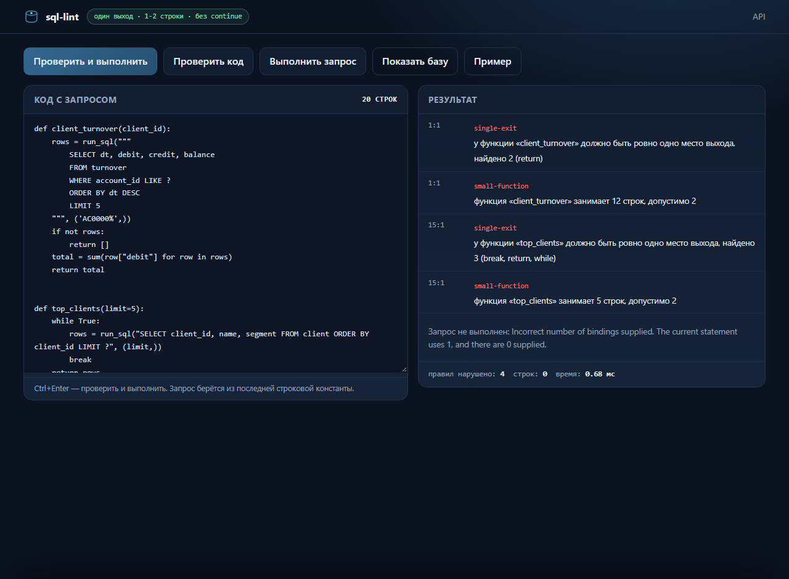

# sql-lint — правила оформления функций и песочница запросов

## Простыми словами

Два инструмента в одном окне. Первый проверяет код на дисциплину оформления:
у функции должен быть ровно один выход, тело — в одну-две строки, без
`continue`. Второй — песочница: берёт SQL из вашего кода, выполняет его на
демонстрационной базе банка и показывает таблицу с данными.

Нажали «Проверить и выполнить» — слева остался код, справа появились нарушения
правил и строки из базы. Нажали «Показать базу» — снизу выезжает панель со
списком таблиц, количеством строк и предпросмотром.

**Где применяется:** ревью пул-реквестов (линтер в CI), обучение аккуратному
стилю функций, быстрый разбор данных без установки клиента БД.

**Как запустить:** `python -m apps.sql_lint.cli serve --port 8766` → http://127.0.0.1:8766



## Правила

| Правило | Что требует | Как считается |
| --- | --- | --- |
| `single-exit` | ровно одно место выхода на функцию | выход — узел `return`, `break` или `while`; ноль выходов — тоже нарушение, обходится флагом `--allow-implicit-exit` |
| `small-function` | тело в 1–2 строки (порог меняется флагом `--max-lines`) | `end_lineno - lineno + 1`, то есть физические строки, включая подпись |
| `no-continue` | без `continue` | предупреждение: `continue` — дополнительный выход, переписывается на `if/else` |

Вложенные функции, лямбды и строки изолированы: выходы внутренней функции не
засчитываются внешней. Разбор идёт по AST, поэтому форматирование и комментарии
на результат не влияют.

```
$ python -m apps.sql_lint.cli lint apps/sql_lint/rules.py
apps/sql_lint/rules.py: 0 нарушений
```

## Песочница

- только чтение: соединение открывается с `PRAGMA query_only = ON`;
- разрешены только `SELECT` и `WITH`, один запрос за раз;
- лимит строк (по умолчанию 200, максимум 1000) и лимит времени (1,5 с) —
  долгий запрос прерывается через `set_progress_handler`;
- SQL берётся из поля `sql` или из последней строковой константы кода;
  f-строки не считаются запросом;
- база наполняется детерминированно: 120 клиентов, счета, 40 дней оборотов,
  портфель и журнал DQ-прогонов.

## API

| Метод | Путь | Назначение |
| --- | --- | --- |
| GET | `/` | страница-песочница |
| GET | `/api/health` | статус, версия, число таблиц |
| GET | `/api/schema` | таблицы, колонки, количество строк |
| GET | `/api/table/{name}?limit=` | предпросмотр таблицы |
| POST | `/api/lint` | `{code, max_lines?}` → нарушения |
| POST | `/api/query` | `{sql}` или `{code}` → строки |
| POST | `/api/analyze` | линт + выполнение за один вызов |

Ошибки всегда в одном формате `{"error": "..."}`; коды — 400 (плохой запрос),
404 (нет маршрута или таблицы), 405 (метод), 413 (слишком большой код).

## Тесты

```bash
python -m pytest apps/sql_lint/tests -q     # 548 тестов
python -m pytest -q                         # 642 теста по всему репозиторию
```

Покрытие — **91.3%** операторов (557 из 610) в шести модулях приложения.
Свой код приложение проверяет собой же: `lint --allow-implicit-exit --max-lines 40`
даёт 0 нарушений по всем шести модулям.
Сайт собирается собственным сборщиком без внешних зависимостей:

```bash
python -m apps.sql_lint.tools.coverage --root apps/sql_lint --target docs/coverage apps/sql_lint/tests
```

Готовый отчёт: [docs/coverage/index.html](../../docs/coverage/index.html) ·
онлайн: https://kepanasyuke.github.io/sql/coverage/

## Структура

```
apps/sql_lint/
├── rules.py            правила и AST-разбор
├── query.py            валидация, лимиты, таймаут, извлечение SQL из кода
├── db.py               схема и детерминированное наполнение
├── server.py           HTTP API и раздача страницы
├── cli.py              lint / query / schema / serve
├── static/app.html     интерфейс: кнопки, результаты, выезжающая база
├── tools/coverage.py   покрытие на sys.monitoring + HTML-сайт
└── tests/              548 тестов
```
