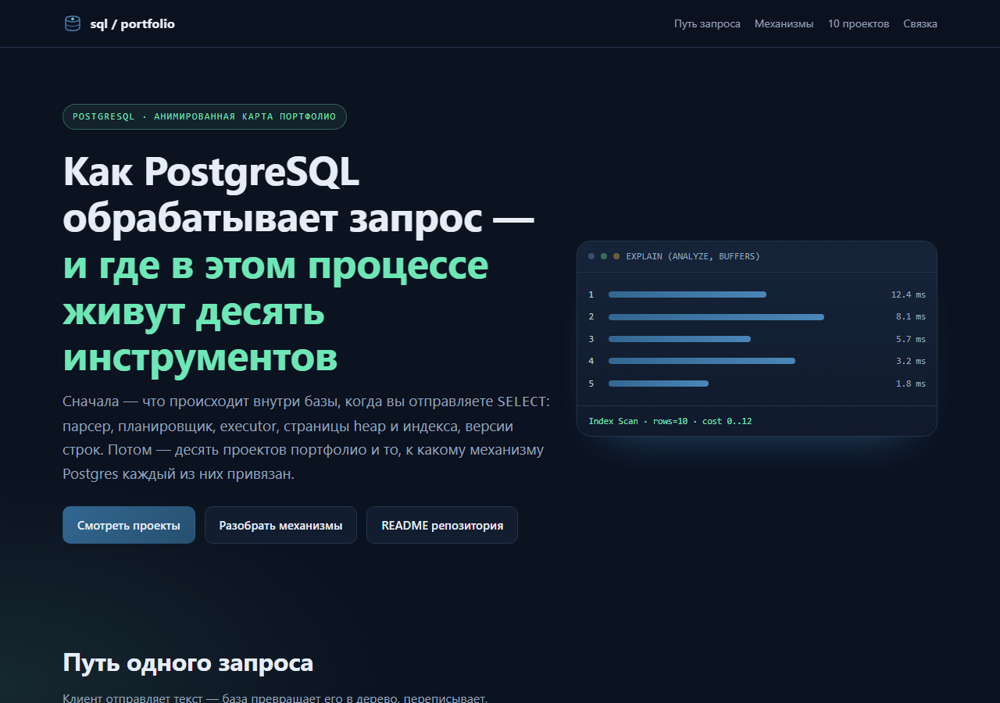
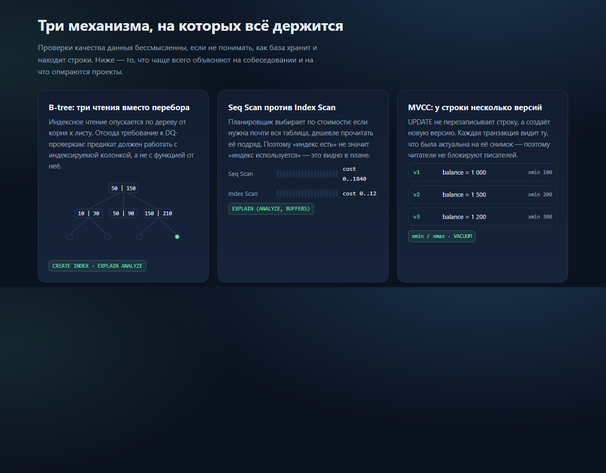
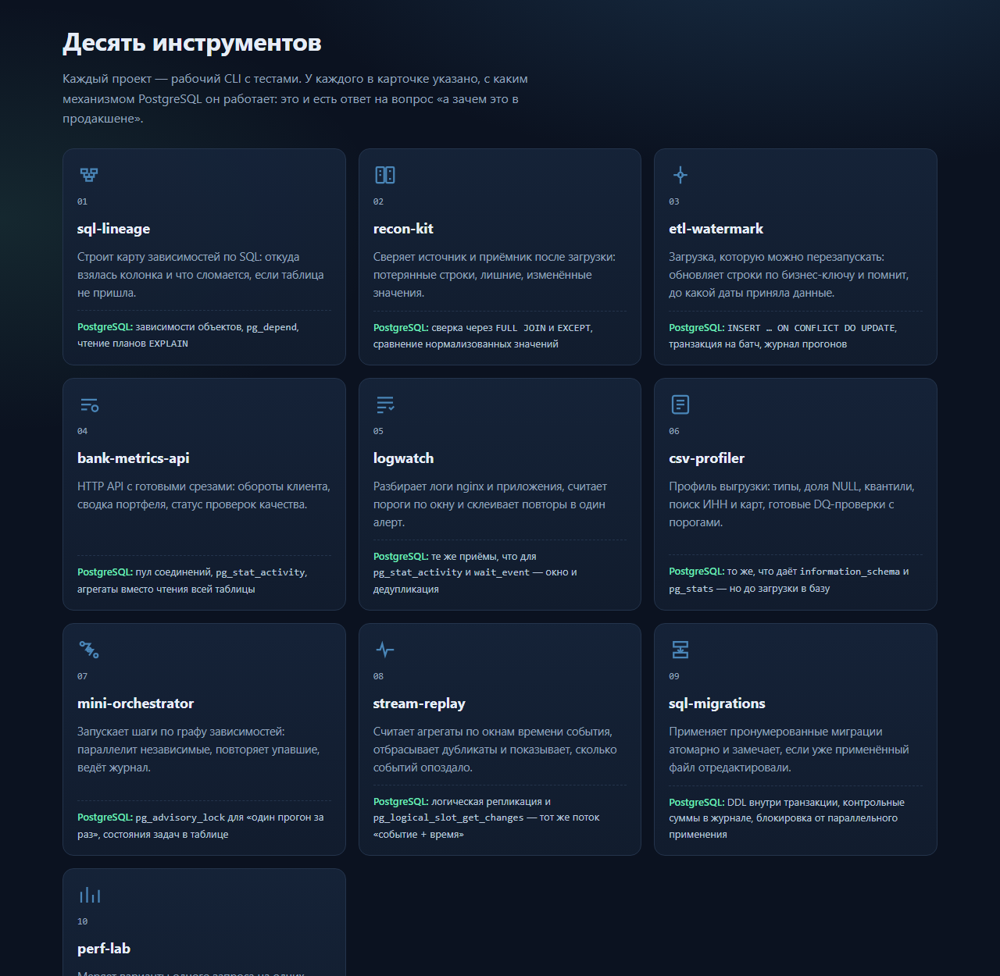

# visuals — анимированная карта портфолио

Одна самодостаточная HTML-страница: что происходит внутри PostgreSQL, когда вы
отправляете `SELECT`, и где в этом процессе живёт каждый из десяти инструментов.

Открыть: двойной клик по `index.html` или `start docs/index.html` в Windows.
Интернет не нужен — CSS, SVG и несколько строк JS лежат в самом файле.

## Скриншоты

| Обложка | Механизмы | Проекты |
| --- | --- | --- |
|  |  |  |

Скриншоты сняты в headless Chrome с `--force-prefers-reduced-motion`
и пересобраны из самой страницы: `?only=mech`, `?only=projects` — режим
предпросмотра, который скрывает остальные секции.

## Что на странице

- **Путь запроса** — клиент → парсер → rewrite → планировщик → executor → heap и
  индекс; точки данных едут по линии (SMIL `animateMotion`).
- **B-tree** — анимация поиска от корня к листу: подсветка пути и найденного ключа.
- **Seq Scan против Index Scan** — две полосы чтения: подряд по всем страницам
  против нескольких страниц по индексу, с ценой плана.
- **MVCC** — три версии одной строки с `xmin`, по очереди «видимые» транзакциям.
- **Десять карточек проектов** — появление при прокрутке, подсветка при наведении,
  у каждой указано, с каким механизмом Postgres она работает.

## Технические детали

- ни одного внешнего запроса: нет CDN, шрифтов из сети и картинок по ссылке;
- анимации на CSS-`@keyframes` и SVG-`animateMotion`, без библиотек;
- при `prefers-reduced-motion: reduce` все анимации и переходы отключаются,
  карточки видны сразу;
- вёрстка адаптивная: сетка карточек перестраивается от 300 px.

**Проверено:** структура HTML без незакрытых тегов и ошибок вложенности,
внешних ресурсов нет; страница открывается локально.
